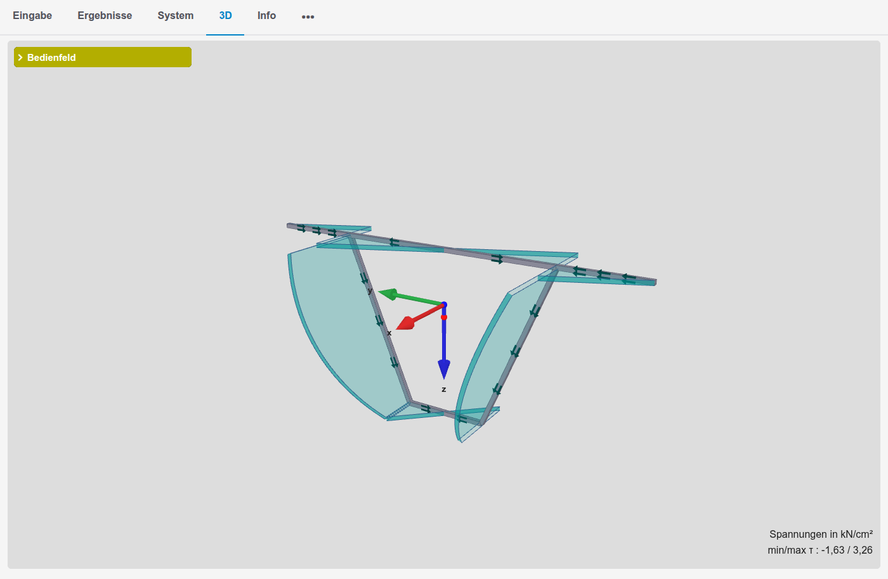

# duennQs – Querschnittswerte und Spannungen dünnwandiger Querschnitte

Eine Web-App für Vorlesung und Übung: Sie berechnet mit der Finite-Elemente-Methode die Querschnittswerte
und Spannungen dünnwandiger Querschnitte (Mittellinienmodell), offen oder geschlossen, auch mit
unterschiedlichen Materialien. Sie läuft im Browser auf Smartphone, Tablet und PC, lässt sich als App
installieren (PWA) und funktioniert danach auch offline. Bedienung mit Maus, Stift oder Finger.

## Funktionen

- Eingabe des Querschnitts über Knoten und Elemente (Dicke, E-Modul, Querdehnzahl je Element)
- ideelle Querschnittswerte: Schwerpunkt, Flächen, Flächenmomente 2. Grades, Hauptachsen,
  Schubmittelpunkt, Torsions- und Wölbwiderstand, Schubkorrekturfaktoren u. a.
- Spannungen aus N, M<sub>y</sub>, M<sub>z</sub>, V<sub>y</sub>, V<sub>z</sub>, primärer und sekundärer
  Torsion und Wölbbimoment: Schubspannungen links und rechts, Normalspannungen, von-Mises-Vergleichsspannungen
- 2D-Grafik des Systems mit Schwerpunkt- und Hauptachsen; Koordinaten und Werte unter dem Cursor bzw.
  Finger, Einrasten an Knoten, Schwerpunkt und Schubmittelpunkt
- 3D-Darstellung von σ, τ, σ<sub>v</sub> (mit f<sub>y,Rd</sub>), Wölbordinate ω und Verwölbung u,
  drehbar und zoombar, Werte unter dem Cursor bzw. Finger; Export als PNG in hoher Auflösung
- Ergebnisse als pdf-Datei
- Knoten- und Elementtabelle mit Zeilen einfügen/löschen, Rückgängig/Wiederherstellen und Kontextmenü
  (Kopieren, Hochzählen, Zwischenablage)
- Eingabe speichern und einlesen (Dateiendung `.duennqs`, auf Android `.duennqs.json`; ältere
  `.txt`-Dateien lassen sich weiter einlesen), Öffnen auch per Drag & Drop; Rückfrage nur bei noch
  nicht gespeicherten Änderungen. Die letzte Eingabe wird im Browser gesichert und beim nächsten
  Start wiederhergestellt
- Querschnitt als Text einfügen, z. B. von einer KI (Claude, ChatGPT …), die ihn aus einer Zeichnung abgelesen
  hat: Der Dialog kopiert einen fertigen Prompt mit Formatbeschreibung, prüft den eingefügten Text und meldet
  Fehler mit Zeilennummer. Textdateien in diesem Format lassen sich auch direkt öffnen
- Längeneinheit mm, cm oder m; Farben der Tabellen und Akzentfarbe einstellbar, helles und dunkles Design
- Sprachen: Deutsch, Englisch, Spanisch, Französisch, Italienisch



## Ausprobieren

Die aktuelle Version läuft unter https://duennqs.statikverstehen.de 😊

Eine Kurzdokumentation steht in der App im Tab *Info*. Die Buttons zeigen einen Hilfetext, wenn man mit
der Maus darüberfährt oder mit dem Finger länger darauf drückt.

## Entwicklung

Benötigt Node.js ≥ 20.19 (Vite 8), empfohlen Node 22.

```bash
npm install
npm run dev        # Entwicklungsserver, öffnet den Browser
npm run build      # Typprüfung (tsc) und Build nach dist/
npm run preview    # Build und Vorschau des fertigen Builds (inkl. Service Worker)
```

Auf Netlify wird bei jedem Push nach `master` automatisch gebaut (`netlify.toml`).

### Übersetzungen

Die Texte im Quellcode sind deutsch (`msg('…')`, [lit-localize](https://lit.dev/docs/localization/overview/)),
die Übersetzungen stehen in `xliff/*.xlf`.

```bash
npm run localize:extract   # neue oder geänderte Texte in die xlf-Dateien übernehmen
npm run localize:build     # src/generated/locales/*.ts erzeugen
```

### Technik

- [Vite](https://vite.dev) + TypeScript, PWA mit [vite-plugin-pwa](https://vite-pwa-org.netlify.app)
- Oberfläche mit [Lit](https://lit.dev) und [Shoelace](https://shoelace.style) im Stil von
  [d2beam-gui](https://d2beam-gui.netlify.app)
- 2D-Grafik mit [Two.js](https://two.js.org), 3D-Grafik mit [three.js](https://threejs.org)
  (wird erst beim Öffnen des Tabs 3D nachgeladen) und [lil-gui](https://lil-gui.georgealways.com)
- pdf mit [jsPDF](https://github.com/parallax/jsPDF)

### Aufbau

| Datei | Inhalt |
|---|---|
| `src/index.ts` | Start, Verdrahtung der Oberfläche |
| `src/components/dr-haupt.ts` | Oberfläche mit den Tabs (Lit, ohne Shadow DOM) |
| `src/duennQ.ts`, `src/gauss.ts` | Berechnung (Finite Elemente) und Ausgabe der Ergebnistabellen |
| `src/eingabe.ts` | Zugriff auf die Eingabe (Tabellen, Felder), Startbeispiel, Dateiformat |
| `src/grafik.ts`, `src/trans.ts` | 2D-Grafik (Tab System) |
| `src/grafik3d.ts` | 3D-Ansicht |
| `src/mypdf.ts` | pdf-Ausgabe |
| `src/dateien.ts`, `src/autosave.ts` | Speichern/Einlesen, automatische Sicherung |
| `src/einstellungen.ts`, `src/localization.ts` | Tab ꔷꔷꔷ (Einheit, Farben, Sprache) |
| `src/sw_update.ts` | Service Worker, Rückfrage bei neuer Version |
| `icon-quelle/duennqs.svg` | Vorlage für die App-Icons in `public/` |

Die App-Icons werden mit [Inkscape](https://inkscape.org) aus `icon-quelle/duennqs.svg` gerendert
(192, 512, Apple-Touch 180, Favicon 48; das maskable Icon mit auf 80 % verkleinerter Figur), z. B.

```bash
inkscape icon-quelle/duennqs.svg --export-type=png --export-filename=public/192x192.png -w 192 -h 192
```

### Gemeinsame Komponenten mit d2beam-gui

`dr-tabelle`, `dr-button-pm`, der Bestätigungsdialog (`confirm_dialog.ts`) und die Hilfetexte
(`touch_hint.ts`) stammen aus d2beam-gui (über quer_2). `dr-tabelle.ts` ist dort und hier bis auf die
Import-Zeilen identisch; die Abhängigkeiten von d2beam-gui werden hier über
`src/components/tabelle_umgebung.ts` ersetzt. Änderungen an der Tabelle sollten deshalb in
allen Projekten nachgezogen werden.

## Kontakt

Rückmeldungen und Fehlerberichte gerne als Issue oder per E-Mail an statikverstehen&#x40;web.de.

© [statikverstehen.de](https://statikverstehen.de) (englischsprachig: [FEA-apps.de](https://fea-apps.de))
